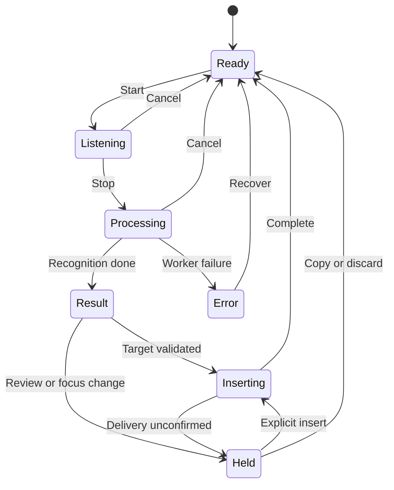

# Offline Bangla Dictation — Detailed Product Requirements Document

**সম্পূর্ণ offline · Free · Open source · Bengali-first desktop dictation**

| Document field | Value |
|---|---|
| Version | 1.0 |
| Prepared | 11 October 2026, Asia/Dhaka |
| Status | Implementation-ready planning draft; model and performance decisions require Gate 0 evidence |
| Product name | Offline Bangla Dictation — working title, final brand TBD |
| Primary audience | Product owner, desktop engineers, speech engineers, designers, QA and open-source contributors |
| Initial release | Windows desktop; shared architecture for macOS and Linux |
| Business model | Free application, public source, no paid transcription or feature tier |
| Processing | On-device only; no transcription API, cloud fallback or proprietary backend |

> এই PRD কোনো তৈরি বা পরীক্ষিত software-এর ফল নয়। এটি build করার specification। Model size-এর documented examples ছাড়া latency, memory, accuracy ও schedule-এর সংখ্যা proposed engineering targets। Gate 0-তে বাস্তব hardware ও বাংলা audio দিয়ে সেগুলো যাচাই করতে হবে।

## 01. Product vision and decisions

বাংলায় স্বাভাবিকভাবে কথা বলে কম্পিউটারের supported textbox-এ দ্রুত লিখতে পারা—একটি ছোট, সুন্দর, নির্ভরযোগ্য application-এর মাধ্যমে। User যেন account, subscription, API key, technical model setup বা আলাদা editor খোলার প্রয়োজন ছাড়াই dictation করতে পারেন।

Core experience: **Shortcut চাপুন → কথা বলুন → shortcut ছাড়ুন → লেখা পান।**

প্রথম release-এর focus হলো accurate recognition, সহজ recording, নিরাপদ text insertion এবং ছোট footprint। Premium এখানে design, typography, reliability ও ব্যবহারযোগ্যতার মান বোঝায়; paid product বোঝায় না।

### 1.1 Confirmed constraints

| ID | Constraint | Meaning |
|---|---|---|
| C-01 | Fully offline | App ও তার product-owned child processes inference, settings, diagnostics বা update-এর জন্য network request করবে না |
| C-02 | Free | সব official core releases বিনামূল্যে; quota, account activation বা paywall নেই |
| C-03 | Open source | Official release-এর corresponding source, build instructions ও notices প্রকাশিত থাকবে |
| C-04 | No own server | App চালাতে নিজের API, inference server, database service বা cloud storage লাগবে না |
| C-05 | Local speech | Audio processing user-এর device-এ হবে; কোনো remote fallback থাকবে না |
| C-06 | Compact and usable | সীমিত feature set, একটি default model, ছোট UI ও সহজ onboarding |
| C-07 | Bengali-first | বাংলাদেশি বাংলা, English terminology ও Bangla–English mixed speech আলাদা evaluation পাবে |
| C-08 | High accuracy | Accuracy-এর ফল measured হবে; সব audio-তে 100% ফলের unsupported guarantee দেওয়া যাবে না |

### 1.2 Accuracy requirement-এর অর্থ

Owner-এর aspiration: **ভুল যতটা সম্ভব শূন্যের কাছাকাছি আনা।** Open-ended speech-এ অস্পষ্ট audio, অজানা নাম, noise ও একইসঙ্গে একাধিক speaker থাকলে প্রতিটি ক্ষেত্রে 100% automatic recognition নিশ্চিত করা যায় না। Whisper-এর published limitations-এ hallucination ও uneven accent/language performance উল্লেখ আছে [S3]।

এই aspiration-কে implementation-এর জন্য তিন ভাগে রূপান্তর করা হচ্ছে:

1. **Recognition quality:** আলাদা বাংলা test sets-এ WER/CER এবং critical entity accuracy মাপা।
2. **Text integrity:** Meaning-changing rewrite default-এ বন্ধ; অস্পষ্ট সংখ্যা আন্দাজ করে বদলানো যাবে না।
3. **Recovery:** User ভুল দেখলে result edit/copy/retry করতে পারবেন; ভুল textbox-এ silent insertion ঠেকানোর ব্যবস্থা থাকবে।

সম্পূর্ণ offline হওয়া একটি যাচাইযোগ্য requirement। প্রতিটি ভবিষ্যৎ audio-তে perfect recognition পাওয়া release claim হবে না। UI-তে fabricated confidence percentage বা “100% accurate” badge থাকবে না।

### 1.3 Initial implementation decisions

| Decision | Initial choice | Evidence gate |
|---|---|---|
| Train a model from scratch | V1-এ করা হবে না | Existing candidates unacceptable হলেও training আলাদা research decision |
| Existing app reuse | Handy-এর pinned release audit ও prototype | Network, license, build ও supported-app tests pass করলে fork/reuse |
| Default inference runtime | Optimized local Whisper-compatible runtime; whisper.cpp baseline | Fork-এর actual runtime, formats ও packaging compatibility যাচাই |
| First model candidate | Multilingual Whisper Small Q5_1 | বাংলা accuracy ও CPU tests |
| Comparison candidate | Multilingual Large-v3-turbo Q5_0 | একই test set/hardware-এ তুলনা |
| Shipped models | একটি selected default | Optional packs manually imported; একসঙ্গে multiple models loaded নয় |
| UI | Existing Tauri/Rust foundation reuse; minimal settings ও recording surface | Product-owned process tree-এর offline behaviour যাচাই |
| First stable platform | Windows 11 x64 | Windows real-device QA |

“Candidate” মানে final choice নয়। Gate 0-এর result ছাড়া Small-কে accurate enough বা Turbo-কে সবসময় better বলা যাবে না।

## 02. Goals, non-goals and success criteria

### 2.1 Product goals

- সাধারণ user পাঁচ মিনিটের মধ্যে install, microphone test ও প্রথম dictation শেষ করতে পারবেন।
- বাংলা typing-এর তুলনায় typical paragraph তৈরির সময় কমবে, correction-সহ।
- Recording state পরিষ্কার থাকবে; background-এ অজান্তে microphone capture হবে না।
- App supported everyday applications-এ result বসাতে পারবে।
- Fresh offline package দিয়ে internet বিচ্ছিন্ন অবস্থায় installation ও প্রথম transcription হবে।
- Source checkout থেকে documented build করা যাবে; runtime-এ Python environment user-কে install করানো হবে না।
- Local files, manual diagnostics ও manual updates দিয়ে user নিজের data ও installation নিয়ন্ত্রণ করবেন।

### 2.2 Explicit non-goals

V1-এ cloud processing, login, subscription, team dashboard, translation, meeting recording, diarization, local chat LLM, automatic email rewriting, always-listening wake word, audio/video batch conversion বা model training থাকবে না।

V2-ও পুরোপুরি offline/free/open source থাকবে। Feature বাড়ানোর জন্য server introduce করা হবে না।

### 2.3 Success evidence

Success শুধু download count দিয়ে বিচার হবে না। Benchmark report, supported-app insertion results, user task completion time, privacy/network report এবং resource measurements release-এর evidence হবে। App telemetry সংগ্রহ করবে না। User research হবে explicit, manual participation-এর মাধ্যমে।

## 03. Users and representative use cases

| User | Task | Product needs |
|---|---|---|
| Bengali everyday user | Messenger, browser comment, document | Easy shortcut, readable Bengali, low setup effort |
| Freelancer or business user | বাংলা বাক্যের মধ্যে client, proposal, meeting | Code-switch preservation, custom vocabulary |
| Student or writer | Paragraph, notes, study material | Natural punctuation, copy fallback, long-turn handling |
| Privacy-focused user | Sensitive personal drafting | No network, no persistent audio, clear microphone state |
| User with typing difficulty | Frequent short dictation | Keyboard access, toggle recording, screen-reader announcements |
| Low-resource laptop user | CPU-only transcription | Honest hardware guidance, one model, power settings |

### 3.1 Primary scenario

User browser-এর message box-এ cursor রাখেন। Configured shortcut ধরে বলেন: “আজকে client-এর সঙ্গে meeting আছে, presentation-টা finalize করতে হবে।” Shortcut ছাড়লে app local processing করে supported field-এ text পাঠায়। Message automatically send হয় না।

### 3.2 Named vocabulary scenario

User dictionary-তে “SubsDrop” বা “Pro Trainer IT” যোগ করেন। App decoding/context অথবা explicit correction rule-এ entry ব্যবহার করার চেষ্টা করে। Dictionary কোনো শব্দ কখনো ভুল হবে না—এমন guarantee দেয় না।

### 3.3 Failure scenario

Processing চলার সময় user অন্য window-তে চলে গেলে app result hold করে। User result copy করেন বা intended field আবার নির্বাচন করে Insert করেন। Recording হারানো বা wrong window-তে silent paste গ্রহণযোগ্য নয়।

## 04. Release scope and prioritization

**P0:** Stable release-এর জন্য mandatory. **P1:** Useful enhancement, release block করে না যদি stated scope-এর বাইরে থাকে. **P2:** Later exploration.

| Feature | V0 proof of concept | V1 Windows stable | V1.1 platform expansion | V2 offline enhancement |
|---|---|---|---|---|
| Local ASR/model comparison | P0 | Selected model | Same evaluation per platform | Continued regression tests |
| Push-to-talk/toggle recording | Prototype | P0 | Platform QA | Retained |
| Safe text insertion | Prototype | P0 supported-app matrix | macOS/Linux adapters | Broader compatibility |
| বাংলা/English/mixed presets | Benchmarks | P0 | Retained | Better adaptation |
| Personal dictionary | Experiment | P0 manual entries | Retained | Confirmed correction learning |
| Controlled punctuation/numbers | Test vectors | P0 conservative subset | Retained | More covered patterns |
| Tray + small recording surface | Basic | P0 | Native behaviour QA | Refined |
| Live partial transcription | Optional experiment | P1; stop-to-transcribe is baseline | Optional | P0 only after quality tests |
| Disk-backed history | None | None | None | P1, explicit opt-in |
| Audio-file transcription | None | None | None | P1, selected formats |
| Voice snippets/editing | None | Minimal formatting commands only | Retained | P1 bounded commands |
| New custom/fine-tuned model | None | None | None | Separate research track |
| Cloud/account/subscription | Excluded | Excluded | Excluded | Excluded |

Live preview না থাকলে V1-কে “continuous live transcription” নামে advertise করা যাবে না। Recording indicator ও stop-to-transcribe experience হবে baseline promise।

## 05. Existing foundation and build-versus-reuse plan

Handy একটি existing MIT-licensed local desktop dictation project; তার repository shortcut-driven capture, local recognition, text paste এবং Windows/macOS/Linux support document করে [S1–S2]। এটি reuse candidate; আমাদের product-এর quality বা zero-network requirement pass করেছে—এমন দাবি করা হচ্ছে না।

### 5.1 Gate 0 foundation audit

| Check | Required evidence | Reject or repair if |
|---|---|---|
| Build | Pinned tag/commit থেকে clean Windows build | Undocumented patches বা external binary dependency |
| Network | Default ও alternate flows-এর process/socket capture | Updater, downloader, remote postprocessing বা embedded assets network use করে |
| Source/license | App, weights ও transitive dependency inventory | Redistribution incompatible বা unclear |
| Recognition | আমাদের বাংলা corpus-এ result | Accuracy baseline unacceptable |
| Insertion | Selected apps-এ Unicode/focus tests | Destructive overwrite বা unreliable paste |
| Footprint | Complete installed/download/RAM measurements | Required budget-এর বাইরে, repair cost too high |
| Maintenance | Fork changes and upstream merge cost estimate | Reuse নতুন app-এর চেয়ে বেশি complex হয়ে যায় |

### 5.2 Reuse policy

Existing foundation ব্যবহার করলে microphone, shortcut, session lifecycle ও platform adapters-এর প্রয়োজনীয় অংশ রাখা হবে। Extra model backend, network clients, remote postprocessing, automatic downloads ও updater code product build থেকে সরানো বা compile-time disabled হবে। শুধু UI থেকে button hide করা যথেষ্ট নয়।

Fork pinned revision থেকে শুরু হবে। Upstream notices ও contribution attribution রাখা হবে; নিজস্ব নাম ও icon আলাদা হবে। Development choices ও modified files documented থাকবে।

Audit fail করলে fallback হলো shared Rust core + small desktop UI + local inference adapter। UI framework বদলাতে হলেও product constraints ও benchmark policy একই থাকবে। Native UI alternative কেবল blocked requirement মেটানোর জন্য বিবেচিত হবে।

## 06. End-to-end user journeys

### 6.1 Offline installation and first run

1. User official full offline package সংগ্রহ করেন বা অন্য computer থেকে copy করেন।
2. Package source/version, model license, file sizes ও checksums-এর information থাকে।
3. Installer local model এবং প্রয়োজনীয় supported runtime থেকে install করে। Network bootstrapper চালায় না।
4. First launch-এ UI language ও microphone নির্বাচন করা হয়।
5. App OS microphone permission চাইলে কারণ সহজ ভাষায় জানায়।
6. App default model খুঁজে local integrity check করে।
7. User shortcut configure করেন; conflict থাকলে warning ও alternative নির্বাচন করতে পারেন।
8. একটি ছোট sample বলেন এবং result app-এর ভেতর দেখেন।
9. Successful sample-এর পরে external textbox-এর first dictation guide দেখানো হয়।

Onboarding-এ model architecture, parameter count বা benchmark jargon front-and-center হবে না। Settings-এর Advanced/About অংশে technical detail থাকবে।

### 6.2 Push-to-talk

Shortcut down → capture starts → clear listening feedback → shortcut up → capture stops → processing indicator → result ready → target validation → insertion or held result।

Shortcut release microphone capture শেষ করবে। Result তৈরির সময় app নতুন audio record করবে না।

### 6.3 Toggle recording

Shortcut প্রথমবার চাপলে শুরু, আবার চাপলে বন্ধ। Persistent listening indicator বাধ্যতামূলক। Escape cancel করবে। Sleep/lock/permission loss capture শেষ করবে। App limit-এর কাছে গেলে warning দেখাবে।

### 6.4 Model missing or corrupt

App “Model প্রয়োজন” অথবা “Model file পড়া যাচ্ছে না” দেখাবে। Local file import বা packaged file reinstall option থাকবে। App নিজে internet থেকে model আনবে না। অন্য file, API বা remote fallback silently নির্বাচন করা যাবে না।

### 6.5 Result review

User চাইলে “Insert after review” নির্বাচন করতে পারবেন। Result editable surface-এ দেখাবে। Insert, Copy, Retry এবং Discard থাকবে। Review mode slow/uncertain names ও important numbers-এর task-এ useful; automatic accuracy guarantee হিসেবে উপস্থাপন করা যাবে না।

## 07. Functional requirement register

| ID | Requirement | Priority | Acceptance outline |
|---|---|---|---|
| FR-001 | Full offline first run | P0 | Network disabled clean target-এ প্রথম transcription |
| FR-002 | No account/activation | P0 | Expired session, offline date change বা reboot-এ core function কাজ করে |
| FR-003 | Microphone selection/test | P0 | Default ও USB device নির্বাচন; level feedback |
| FR-004 | Permission recovery | P0 | Denial/revoke করলে readable error; retry সম্ভব |
| FR-005 | Configurable global shortcut | P0 | Conflict detection; supported keys; locale test |
| FR-006 | Hold and toggle recording | P0 | Correct start/stop events; stuck-key recovery |
| FR-007 | Visible recording state | P0 | Capture চললে persistent indicator |
| FR-008 | Cancel/lock/sleep cleanup | P0 | Audio capture stops; cancelled result later insert হয় না |
| FR-009 | Single-session lifecycle | P0 | Concurrent hotkey events duplicate job/insert তৈরি করে না |
| FR-010 | Silence handling | P0 | Silent session-এ inserted text নেই |
| FR-011 | বাংলা/English/mixed presets | P0 | Stored setting; independently evaluated recognition |
| FR-012 | Faithful output | P0 | No default meaning/style rewrite |
| FR-013 | Punctuation and normalization | P0 | Covered transformations pass golden tests |
| FR-014 | Number style selection | P0 | বাংলা digits, Latin digits বা spoken words; ambiguous input preserved |
| FR-015 | Personal dictionary CRUD | P0 | Add/edit/remove/import/export; changes persist locally |
| FR-016 | Dictionary-assisted decoding | P0 | Effective engine behaviour documented; regression measured |
| FR-017 | Explicit replacement rules | P0 | User-approved phrase rules only; reversible, bounded |
| FR-018 | Local model loading/import | P0 | Supported file format, validation, readable failure |
| FR-019 | Model readiness and memory policy | P0 | Ready/Saver behaviour; unload after configurable idle period |
| FR-020 | Processing status and recovery | P0 | Loading/transcribing/error distinct; UI stays responsive |
| FR-021 | Supported textbox insertion | P0 | Matrix-এর required cases pass |
| FR-022 | Focus/sensitive-target guard | P0 | Known unsafe state হলে result hold হয় |
| FR-023 | Clipboard integrity | P0 | App user-এর newer clipboard content overwrite করে না |
| FR-024 | Pending-result copy/edit/retry | P0 | Failure/focus change-এর পরে result recoverable |
| FR-025 | Bounded last-insertion undo | P0 | Target/text validation pass করলে only own last insertion undo |
| FR-026 | UI ভাষা ও theme | P0 | বাংলা/English interface; light/dark/system |
| FR-027 | Accessible keyboard interface | P0 | Onboarding/settings/result mouse ছাড়াই usable |
| FR-028 | Startup and exit controls | P0 | Login startup opt-in; Exit capture ও workers বন্ধ করে |
| FR-029 | Settings/dictionary local backup | P0 | Export/import without audio/transcript leakage |
| FR-030 | Manual offline update | P0 | Local package update; settings preserved; no polling |
| FR-031 | Local sanitized diagnostics | P0 | User review/export; no automatic upload |
| FR-032 | Session length and resource limits | P0 | Limit reached হলে graceful stop; audio silently drop নয় |
| FR-033 | Explicit formatting commands | P0 subset | Enabled হলে newline/paragraph commands; literal mode available |
| FR-034 | Live partial preview | P1 | Preview marked draft; final text only commit policy |
| FR-035 | Optional local history | V2 P1 | Default off; retention/delete/export defined |
| FR-036 | Offline file transcription | V2 P1 | Selected formats, local decoder, TXT/MD/SRT where supported |
| FR-037 | Voice snippets | V2 P1 | Explicit configured phrase; no accidental external send |
| FR-038 | Confirmed correction learning | V2 P1 | User confirmation creates inspectable rule; no hidden training |
| FR-039 | Expanded desktop compatibility | V1.1 P0 | Platform-specific acceptance matrix published |
| FR-040 | Source and release transparency | P0 | Corresponding source, manifests, licenses and known issues shipped |

“P0” কোনো current implementation claim নয়। Register-এর tests ও detailed behaviour নিচের sections-এ নির্ধারিত।

## 08. UI, information architecture and visual quality

### 8.1 Surfaces

| Surface | Required content | Behaviour |
|---|---|---|
| Tray menu | Start/stop, selected language, Settings, Exit | Small, consistent, keyboard accessible |
| Recording surface | Listening state, elapsed time, Stop/Cancel | Non-activating where supported; target field-এর focus নেয় না |
| Processing surface | Loading/Transcribing state | Does not imply recording continues |
| Pending result | Text, Edit, Insert, Copy, Retry, Discard | Only when requested or automatic insertion blocked |
| Settings | Dictation, Microphone, Language, Dictionary, Models, Privacy, About | Clear grouping; few advanced options |
| Onboarding | Permissions, mic, shortcut, model, sample | Short guided flow, no account step |

No oversized dashboard, decorative chart, random emoji, excessive gradient বা marketing popup থাকবে। Icons কেবল meaningful action/state বোঝাতে ব্যবহার করা হবে; icon-only button-এর accessible label থাকবে।

### 8.2 Typography and layout

- বাংলা glyph ও কার/ফলা যেন clipping ছাড়াই পড়া যায়।
- Bengali-friendly font fallback; bundled font হলে redistribution license ও all-in size manifest-এ থাকবে।
- Settings body typography আনুমানিক 14–16 px; Bengali copy-এর জন্য পর্যাপ্ত line height। Final values device QA-তে ঠিক হবে।
- Text contrast normal text-এর জন্য অন্তত 4.5:1; colour একমাত্র state indicator হবে না।
- Light/dark/system theme; restrained accent, consistent spacing, minimal controls।
- 100%, 125%, 150%, 200% scaling এবং multiple-monitor DPI change-এ layout test।
- Recording surface drag/move option; screen reader announcement ও reduced motion support।
- Main settings window close করলে active recording বন্ধ হবে না যদি user explicitly recording চালু রেখেছেন; Exit অবশ্যই বন্ধ করবে। Close বনাম Exit wording আলাদা হবে।

### 8.3 User-facing wording

| Situation | Example Bengali copy |
|---|---|
| Ready | “কথা বলার জন্য প্রস্তুত” |
| Capturing | “শুনছি…” |
| Processing | “লেখা তৈরি হচ্ছে…” |
| No speech | “কথা পাওয়া যায়নি। আবার চেষ্টা করুন।” |
| Focus changed | “লেখাটি প্রস্তুত। যেখানে লিখবেন, সেটি নির্বাচন করুন।” |
| Unsupported target | “এখানে লেখা বসানো যায়নি। Copy ব্যবহার করুন।” |
| Missing model | “Model file যোগ করুন।” |
| Poor signal | “Microphone-এর শব্দ খুব কম। একটু কাছে এসে বলুন।” |

Technical errors-এর expandable detail থাকবে, তবে raw stack trace সাধারণ flow-তে দেখানো হবে না।

## 09. Audio capture and session lifecycle

### 9.1 Capture contract

OS device format থেকে model-required audio format-এ local conversion হবে; baseline input হলো 16 kHz mono audio। Actual conversion, resampling ও sample precision inference adapter contract-এ pin হবে।

Capture thread inference বা UI কাজ করবে না। Bounded audio buffer, explicit session ID এবং worker coordination থাকবে। Mic handle capture শেষ হলে release করতে হবে।

Baseline limits: V1-এ একটি turn সর্বোচ্চ 120 seconds; 90 seconds-এ warning। Limit reached হলে capture graceful stop ও existing audio process হবে। User text হারাবেন না। Long-turn latency separately report হবে; short-turn target 120-second turn-এর জন্য promise নয়।

### 9.2 VAD and preprocessing

- VAD silence/no-speech filtering-এর জন্য; very quiet speech বাদ না যায় তা test করা হবে।
- Short pre/post padding রাখা যাবে, যাতে প্রথম/শেষ consonant না কেটে যায়। Padding ও thresholds benchmarked হবে।
- Noise suppression optional এবং clean/noisy speech-এর A/B ফল দেখে enabled হবে।
- Echo cancellation শুধু actual playback/echo use case-এ প্রয়োজন হলে; mandatory multi-stage DSP নয়।
- VAD বা signal-level warning recognition accuracy percentage হিসেবে দেখানো যাবে না।
- Legitimate repetition, যেমন “না না, সেটা না”, blindly remove করা যাবে না।

### 9.3 States and cancellation

Session cancelled হওয়ার পরে worker late result দিলেও session ID দিয়ে discard হবে। Restarted worker পুরোনো target-এ insert করবে না।

Shortcuts processing-এর সময় repeated trigger করলে bounded behaviour হবে: busy feedback অথবা cancel-and-restart explicitly configured action। Concurrent inference jobs unbounded queue করা যাবে না।

## 10. Language and output behaviour

| Preset | Recognition intention | Output intention |
|---|---|---|
| বাংলা | Bengali speech, common foreign terms | Bengali script; user-approved English spelling preserved where recognized |
| English | English speech | English transcription |
| বাংলা + English | Code-switched speech | Spoken language mixture preserved; no automatic translation |

Language preset selection, prompt/context and decoder settings-এর effect benchmark করতে হবে। Bengali language hint English words suppress করছে কি না mixed set-এ পরীক্ষা জরুরি। Auto language detection-এর ওপর short utterance পুরোপুরি নির্ভর করবে না।

Roman Bangla output/transliteration V2 option হতে পারে। এটি recognition থেকে আলাদা conversion; “Banglish speech recognition” এবং “সব বাংলা Latin script-এ লেখা” একই feature নয়।

V1-এ regional accent evaluation থাকবে; সব regional language/dialect-এর full support ঘোষণা হবে না। Published supported-language statement actual test coverage reflect করবে।

## 11. Faithful normalization and number safety

### 11.1 Default rules

Default mode spoken meaning, tense, negation, names, amount ও language mixture সংরক্ষণ করবে। LLM দিয়ে paragraph paraphrase হবে না। Casual speech automatically formal Bengali-তে rewrite করা যাবে না।

Safe baseline: whitespace cleanup, tested Unicode normalization, covered punctuation এবং optional number-format conversion। Bengali ZWJ/ZWNJ ও spelling distinctions না বুঝে remove করা যাবে না।

Punctuation ASR থেকেই আসতে পারে। অতিরিক্ত rules duplicate punctuation তৈরি করছে কি না পরীক্ষা হবে। Automatic sentence boundary ভুল হলে user off করতে পারবেন।

### 11.2 Number conversion policy

Number style: Bengali digits / Latin digits / spoken words। Full parse এবং supported unambiguous grammar ছাড়া conversion করা যাবে না। Original recognition text memory-তে retained থাকবে যাতে user undo/review করতে পারেন।

| Input text from ASR | Bengali digits setting | Rule |
|---|---|---|
| তিন লাখ বিশ হাজার টাকা | ৩,২০,০০০ টাকা | Covered integer amount |
| এক লাখ পঞ্চাশ হাজার | ১,৫০,০০০ | Covered integer |
| চল্লিশ হাজার টাকা | ৪০,০০০ টাকা | Covered integer amount |
| পাঁচটা ফাইল | পাঁচটা ফাইল | V1 conservative policy: classifier-attached colloquial count conversion optional later |
| এক দুই শূন্য পাঁচ | এক দুই শূন্য পাঁচ | Separate digits not silently joined |
| আগামী শুক্রবার | আগামী শুক্রবার | Relative day not guessed as calendar date |
| তিন থেকে পাঁচ হাজার | তিন থেকে পাঁচ হাজার | Ambiguous range left unchanged unless dedicated covered rule |

এগুলো raw ASR recognition guarantee নয়। Correct input text পেলে number formatter-এর deterministic behaviour। Speech-এ “বিশ” ভুল শোনা গেলে formatter তা প্রমাণ ছাড়া ঠিক করতে পারবে না।

### 11.3 High-risk content

Name, phone number, address, date, amount এবং negation-এর exact-match metric আলাদা থাকবে। Unknown/ambiguous critical entity guessed replacement হবে না। UI review available থাকবে; model confidence perfect error detector নয়।

## 12. Personal dictionary and corrections

### 12.1 Entry types

| Type | Example | Behaviour |
|---|---|---|
| Preferred term | SubsDrop | Relevant decoder context/hint where supported |
| Technical term | Next.js | Preferred spelling; context limits apply |
| Explicit phrase alias | সাবসড্রপ → SubsDrop | Only user-enabled exact phrase rule |
| Protected output term | Pro Trainer IT | Normalizer should not rewrite confirmed term |

Dictionary UI-তে term, optional language/preset এবং optional spoken alias থাকবে। V1-এ entry limit-এর প্রাথমিক budget 500; decoder prompt-এ সব entry blindly ঢোকানো হবে না। Prompt/context budget অনুযায়ী subset ব্যবহার ও behaviour documented হবে।

### 12.2 Correction policy

- User manual entry যোগ করবেন; unrelated application-এর text বা keyboard input silently পড়া হবে না।
- “আপনার correction থেকে শিখেছে” বলতে visible entry/rule তৈরি হওয়া বোঝাবে। V1-এ weights train হবে না।
- Replacement partial substring-এর বদলে tested phrase/token boundaries ব্যবহার করবে। Bengali suffix ও punctuation behaviour golden tests-এ থাকবে।
- Conflicting rules validation message দেবে; chained replacements capped হবে।
- Rule preview ও Disable/Delete থাকবে।
- New dictionary feature held-out set-এর accuracy খারাপ করলে default behaviour revise করতে হবে।

Local dictionary import/export JSON হবে; unsupported schema, malformed file ও excessive entry count reject হবে। Import source file execute করা যাবে না।

## 13. System-wide insertion and clipboard integrity

### 13.1 Capability-based insertion

App নিজস্ব editor-এর বাইরেও supported text fields-এ কাজ করবে। Native/accessibility insertion অথবা Unicode keyboard path ব্যবহার করা যায়; unsupported targets-এর জন্য clipboard/manual copy fallback থাকবে। Specific method platform/app অনুযায়ী validated হবে।

Text injection সব app-এ সমান নয়; privileges, sandbox, rich editor ও display server-এর constraint থাকে [S9–S10]। Marketing wording হবে “supported applications” অথবা published matrix অনুযায়ী।

### 13.2 Focus rules

Recording start-এ target process/window এবং available focused-control identity local session metadata হিসেবে রাখা হবে। Insertion-এর ঠিক আগে পুনরায় validate হবে। UI overlay focus steal করবে না।

Target changed, secure desktop, locked screen, unsupported sensitive field, unexplained selection বা unreliable target identity হলে automatic insertion বন্ধ; result held। Unknown fields-এ “সব sensitive field detect হয়েছে” দাবি করা যাবে না।

Password/secure-input field যেখানে OS reliably identify করে, dictation/insertion block হবে। App selected field-এর beyond full page/document context পড়বে না।

### 13.3 Selection and destructive edits

V1-এর safe default selected text overwrite করবে না। Replacement যদি future option হয়, explicit setting, visible action এবং tested undo প্রয়োজন। Enter/Send shortcut automatically চাপা হবে না।

### 13.4 Clipboard fallback

- Clipboard ব্যবহার করলে previous supported content snapshot ও clipboard ownership/version track হবে।
- User নতুন কিছু copy করলে app পুরোনো snapshot restore করে সেটি overwrite করবে না।
- Multiple-format clipboard faithfully preserve করা না গেলে text-only destructive restore করা যাবে না; safer insertion/manual Copy path নির্বাচন হবে।
- Fixed delay-কে successful paste-এর প্রমাণ ধরা যাবে না। Receiving control read/ack available হলে তা ব্যবহার; otherwise delivery attempted status ও held recovery থাকবে।
- File/image clipboard, large clipboard ও concurrent clipboard managers test করা হবে।
- Dictated text external app-এ পাঠানো user-authorized operation; app নিজে network-এ পাঠাচ্ছে না। Destination app-এর নিজস্ব behaviour আমাদের offline boundary-এর বাইরে।

### 13.5 Undo

Only most recent app-owned insertion, original target unchanged এবং inserted range/text verifiable হলে undo available। অন্য app-এ blind Ctrl+Z পাঠানো যাবে না। Range verify করা না গেলে app result correction/manual editing guide দেবে; user-এর unrelated work undo করবে না।

Last-result buffer current session/limited recovery memory-তে থাকবে; V1-এ automatic transcript history file হবে না।

## 14. Formatting commands and voice controls

V1 subset: explicit “নতুন লাইন” এবং “নতুন অনুচ্ছেদ” command interpretation। Feature off থাকলে words literal transcription হবে। Unsupported complex editing command execute হবে না।

Command parser default dictation-এর মধ্যে accidental action ঠেকাতে setting ও exact covered patterns ব্যবহার করবে। “নতুন লাইন কথাটা লিখুন” যেন command trigger না করে—এর জন্য literal escape/review option থাকবে।

V2 snippets এবং bounded editing commands করতে পারে। Voice command কোনো message send, file delete, shell execute বা arbitrary application automation করবে না।

## 15. Local model selection and packaging

### 15.1 Candidates

| Candidate | Published weight file | Size example | Role |
|---|---|---:|---|
| Multilingual Whisper Small | ggml-small-q5_1.bin | প্রায় 190 MB | Compact baseline |
| Multilingual Whisper Medium | ggml-medium-q5_0.bin | প্রায় 539 MB | Optional comparison if Small inadequate |
| Multilingual Whisper Turbo | ggml-large-v3-turbo-q5_0.bin | প্রায় 574 MB | Accuracy/speed comparison |
| Bengali IndicConformer | Exact release/format TBD | Benchmark before size commitment | Research comparison; desktop deployment effort assessed separately |

Whisper examples-এর file sizes current publisher listing-এর examples [S5]; version/hash pin করার পরে exact bytes release manifest-এ লিখতে হবে। RAM ও installed package size এই table থেকে infer করা যাবে না। Bengali-এর জন্য `.en` weights নির্বাচন করা যাবে না।

Bengali IndicConformer card NeMo-based usage document করে [S8]। Model architecture name alone streaming readiness বা Banglish quality establish করে না।

### 15.2 Selection process

1. একই corpus, normalization policy, CPU/GPU ও decoder configuration দিয়ে candidates চালানো।
2. WER/CER, critical entities, hallucination, p50/p95 final latency, memory এবং processing real-time factor collect করা।
3. Compact candidate quality gate pass করলে সেটি default হতে পারে। না করলে অন্য candidate বা staged beta প্রয়োজন।
4. Accuracy গোপনে কমিয়ে package target মেটানো যাবে না। Gate 0 decision record-এ tradeoff লিখতে হবে।
5. একটি default model ship; optional larger pack manual file import হিসেবে আলাদা।

### 15.3 Model manifest

প্রত্যেক supported pack-এ model ID, version, original source URL, SHA-256, exact size, model license, runtime format, supported languages, quantization ও measured hardware results থাকবে। Manifest local; app remote registry poll করবে না।

Unknown custom pack “Community / not evaluated” হিসেবে দেখানো হবে। Unsupported format, corrupt file ও invalid header reject হবে। Arbitrary Python pickle/model script loading থাকবে না। Hash known pack-এর integrity যাচাই করে; unknown pack-এর quality বা safety guarantee করে না।

### 15.4 No custom training in V1

নিজস্ব বাংলা rules ও vocabulary layer তৈরি হবে; নতুন foundation ASR training হবে না। Fine-tuning/distillation পরে হলে data rights, held-out speakers, reproducible recipe এবং compatible exported format প্রয়োজন। Speech dataset কখনো app থেকে silent collection হবে না।

## 16. Technical architecture

Architecture-এর উদ্দেশ্য হলো UI responsive রাখা, local inference encapsulate করা এবং platform-specific behaviour আলাদা করা। Backend service, Redis, PostgreSQL, authentication gateway বা cloud worker প্রয়োজন নেই।

| Component | Responsibility | Boundary |
|---|---|---|
| Desktop shell | Tray, permissions, app lifecycle, settings window | OS-specific thin adapter |
| Session controller | Start/stop/cancel, target snapshot, job state | Single authoritative state machine |
| Audio module | Capture, resample, bounded PCM buffers | UI/inference থেকে আলাদা execution |
| VAD/preprocessing | No-speech handling, measured optional DSP | Speech edges preserve |
| Inference adapter | Model load, decode, cancel, progress, result | Local C/C++ runtime বা audited reusable equivalent |
| Text processor | Dictionary assistance, punctuation, covered numbers | No LLM paraphrasing |
| Insertion adapter | Native/Unicode/paste, target validation, bounded undo | Windows/macOS/Linux implementations |
| Local preferences | Settings, dictionary, model manifests | Versioned local files |
| Diagnostics | Sanitized codes and timings | Manual export only |

### 16.1 Stack proposal

- Existing Handy foundation pass করলে its shared Rust/Tauri/TypeScript structure retain করা। নতুন UI framework migration দিয়ে scope বাড়ানো হবে না।
- Baseline local runtime হিসেবে whisper.cpp evaluate; C API বা audited wrapper দিয়ে integrate। Existing wrapper-এর actual dependency ও build flags inspect করতে হবে [S4]।
- Runtime-এ one active model/context; model switch-এর সময় old context unload বা bounded handoff।
- UI assets, fonts, CSS এবং translations package-এর মধ্যে থাকবে। CDN বা remote webpage নয়।
- Local OS audio APIs বা small native capture dependency; runtime Python interpreter নেই।
- V1 settings/dictionary JSON files; SQLite শুধু V2 local history বাস্তবে প্রয়োজন হলে যোগ হবে।

Tauri system WebView ব্যবহার করে [S6]। তাই app shell ছোট হতে পারে, কিন্তু complete installer-এর runtime dependency আলাদা হিসাব করতে হবে। WebView background networking বা telemetry product-owned process tree-এ থাকলে সেটি Gate 0-তে resolve করতে হবে। UI hide করে compliance claim করা যাবে না।

### 16.2 Thread/process policy

Audio capture, inference এবং interface work আলাদা execution context-এ থাকবে। Lock-free queue mandatory নয়; bounded queue এবং measured reliability গুরুত্বপূর্ণ।

Inference worker dedicated native process হলে UI crash isolation ও cancel/restart সহজ হতে পারে। In-process worker audit-এ simpler ও safe হলে তা গ্রহণযোগ্য। Gate 0-তে একটি approach নির্বাচন হবে; উভয় implementation একসঙ্গে maintain নয়।

IPC local named pipe/Unix socket/stdin-stdout বা equivalent OS IPC হবে। Local HTTP server, open listening port বা remote debugging endpoint প্রয়োজন নেই। IPC caller identity ও input size validate হবে।

Model preloading, quantization, reusable buffers ও thread budget benchmark করে ব্যবহার করতে হবে। Memory mapping মানেই actual resident RAM কমে গেছে—এমন দাবি করা যাবে না।

### 16.3 Inference adapter contract

| Operation | Required outcome |
|---|---|
| inspect_model | Supported format/version, load eligibility, helpful failure |
| load_model | Ready event, measured loading time, bounded memory |
| transcribe | session_id, local audio, preset/options → raw text and engine metadata |
| cancel | Cancel request acknowledged; late result never inserted |
| unload_model | Workers/accelerator resources released; lifecycle verified |
| health | Ready/busy/error state without network |

Every job/result carries session_id এবং model_id। Result includes raw text, normalized text, timing, no-speech signals if available, and provenance for transformations। Engine confidence score থাকলে তা uncalibrated internal evidence; percentage accuracy label নয়।

### 16.4 Failure containment

Worker crash হলে microphone capture বন্ধ, error state এবং retry option থাকবে। App immediate unbounded auto-retry করবে না। Current audio bounded recovery buffer-এ রাখা থাকলে explicit Retry; Cancel/Exit করলে discard।

Out-of-memory risk হলে clear local error, optional smaller supported model suggestion এবং no forced model download। GPU unavailable হলে CPU fallback local-only; expected speed change জানাতে হবে। Fallback quality differences benchmarked থাকবে।

## 17. Local storage and data lifecycle

| Data | V1 default | Lifetime | Export behaviour |
|---|---|---|---|
| Raw microphone audio | Bounded memory buffer | Active session/retry only; cancel/exit after release | Not in diagnostics or settings export |
| Raw/final transcript | Memory only | Current/pending result and bounded last-insertion recovery | User Copy/save action only |
| Settings | Versioned local JSON | Until reset/uninstall policy | Manual settings backup |
| Dictionary and rules | Versioned local JSON | User-controlled | Manual JSON export |
| Model weights | Local files | Until user removes pack | User-provided/imported package |
| Model manifest | Local JSON | With pack | About/diagnostics metadata, no speech |
| Operational diagnostic log | Sanitized, bounded local metadata | Default capped at 2 MB and rotating | Explicit user preview/export |
| Transcript history | Not stored in V1 | V2 opt-in only | See Section 29 |

### 17.1 Settings schema principles

Settings include schema_version, UI language, selected microphone, shortcut, recording mode, language preset, number style, punctuation options, review mode, ready/saver policy and selected model ID।

Dictionary entries include ID, preferred term, optional spoken alias, rule type, preset and enabled flag। Full OS username/path, document title বা transcript diagnostic payload-এ default রাখবে না।

Write operations atomic replace pattern বা equivalent integrity mechanism ব্যবহার করবে। Invalid JSON হলে clear recovery এবং last-known valid settings backup; corrupt dictionary silently delete নয়। Migrations backwards compatibility বা rollback instruction নিয়ে ship হবে।

### 17.2 Audio privacy limits

Product audio file লিখবে না। তবে OS paging, crash dumps, clipboard ও destination application-এর behaviour পুরোপুরি app-এর নিয়ন্ত্রণে নয়। “কোনো অবস্থাতেই computer-এ কোনো trace থাকবে না” claim হবে না। Product-owned logging ও dump configurations sensitive content বাদ দেবে; buffers best-effort promptly released হবে।

Shared computer-এ local settings/dictionary-এর access OS user permissions দিয়ে সীমিত থাকবে। Private profile default locations documented হবে। V1-এ history না থাকায় transcript database encryption dependency প্রয়োজন নেই।

## 18. Offline and privacy requirements

| ID | Non-functional requirement | Verification |
|---|---|---|
| NFR-001 | Product-owned outbound network connections: zero | Process/socket monitoring with network on and off |
| NFR-002 | No inbound service/listener required | Port/IPC inspection; remote-debug build flags off |
| NFR-003 | No automatic audio/transcript/diagnostic upload | Source paths plus run-time checks |
| NFR-004 | Fresh offline install works | Clean supported machine, network disabled |
| NFR-005 | Offline operation has no expiration | Restart/date-change/core function tests |
| NFR-006 | No silent persistent speech data | Filesystem change analysis after session/cancel/crash |
| NFR-007 | Permissions least necessary | Document exact mic/accessibility needs; no full disk/network entitlement without justified requirement |
| NFR-008 | Assets and required runtime locally available | Complete offline installer and package manifest |
| NFR-009 | Memory/CPU budget measured across process tree | Resource profiling on reference device |
| NFR-010 | UI responsive during inference | Cancel/settings interaction tests under load |
| NFR-011 | No destructive wrong-target insertion in guard suite | Focus/selection/secure-target scenarios |
| NFR-012 | Unicode and clipboard integrity | Bengali/rich-content/concurrent-copy tests |
| NFR-013 | Accessible text/controls/scaling | Keyboard, screen reader, contrast and DPI review |
| NFR-014 | Versioned, reproducible build recipe | Clean source build and dependency/model hashes |
| NFR-015 | License/notice completeness | Release dependency and model inventory |
| NFR-016 | Published limitations and benchmark reproducibility | Release report, dataset definitions, runner/config |
| NFR-017 | No unbounded sessions/jobs/resources | Session limits, stress and long-run tests |
| NFR-018 | Updates preserve local preferences safely | Offline upgrade/rollback QA |

### 18.1 Network boundary

App, its worker এবং app-created WebView processes NFR-001-এর আওতায়। DNS lookups, analytics, remote fonts, model downloads, updater polling, remote LLM SDK এবং loopback HTTP listener product build থেকে বাদ থাকবে।

User browser-এ source/download page খোলা একটি explicit external-browser action হতে পারে; app API/download request করবে না। Release information local file থেকে পড়বে। No update checking banner requiring internet।

OS-এর independent update service, user browser এবং receiving application-এর traffic app-এর zero-network claim-এর বাইরে। Product নিজে সেসব trigger করে offline install complete করতে পারবে না। Scope transparent থাকবে।

### 18.2 Verification scenarios

Fresh install, first run, successful/failed dictation, model import, model error, diagnostics, About, idle, startup, shutdown, suspend/resume এবং update—সব flows capture হবে। Only “Wi-Fi off-এ কাজ করে” দিয়ে zero-network প্রমাণ হবে না; network available অবস্থায় request attempt-ও observe করতে হবে।

### 18.3 Security implementation

Release builds-এ remote developer tools disabled, IPC commands allowlisted, file imports size/format validated এবং untrusted script execution absent থাকবে। Dependencies pinned এবং scanner findings triaged হবে। Signed manifests/checksums authentic release থেকে verify করার instructions থাকবে।

App microphone stream থেকে voice identity, sentiment বা private profiling করবে না। No user account identifier বা device fingerprint তৈরি হবে।

## 19. Footprint and performance budgets

### 19.1 Measurement definitions

**Download size:** user যে complete package download/copy করেন তার bytes। **Installed size:** app, weights, required runtime এবং optional accelerator files-এর total local bytes; shared OS component আলাদা category-তে দেখানো হবে।

**RAM:** app + app-owned workers + app-created WebView processes-এর measured working set/private memory। GPU dedicated/shared memory আলাদা report; inference model file size RAM estimate নয়।

**Warm:** selected model loaded এবং initial runtime compilation finished। **Cold:** app/model first load বা cache absent। Readiness setting ছাড়া warm latency advertise করা যাবে না।

### 19.2 Proposed resource budgets

| Metric | Initial engineering budget | Conditions |
|---|---:|---|
| Own app binaries/UI/assets | ≤80 MB | Excludes weights and separately listed OS/acceleration runtime; actual total always shown |
| Compact model weight | প্রায় 190 MB candidate | Exact pinned file size replaces example |
| Compact app + default model installed footprint | ≤350 MB target | CPU-first Windows package; shared OS runtime separately itemized |
| Full compact offline Windows package | ≤500 MB download target | Includes required local runtime payload; optional GPU packs not bundled; total verified before release |
| Idle RAM, model unloaded | ≤180 MB | Settings closed; full product process tree |
| Idle CPU | <1% average over 60 seconds | No recording/inference; fixed measurement methodology |
| Compact model active peak RAM | ≤1.5 GB target | Reference device; selected runtime; includes UI/workers |
| UI feedback after shortcut | p95 ≤100 ms | App running, input path ready |
| Warm final transcription latency | p95 ≤2 seconds | 3–15-second clean turns on selected reference device |
| Capture stop after Cancel | p95 ≤250 ms | Audio device operation; worker computation can take longer to acknowledge |
| Processing real-time factor | ≤0.5 target for short batch benchmark | Runtime-specific; report with warm latency |
| Long-run memory growth | ≤20% after steady-state repeated sessions | Warm-up excluded; real leak also investigated |

এই budgets prototype hypotheses। Small candidate gate pass না করলে অন্য model-এর জন্য all-in budgets revise এবং documented decision করতে হবে; result গোপন রেখে একই lightweight claim ব্যবহার নয়।

### 19.3 Reference hardware

Gate 0-তে actual tested CPU SKU/architecture, RAM, OS build এবং power settings freeze হবে। Initial reference class: Windows 11 x64, 8 GB RAM, modern 4-core-or-better AVX2 CPU, CPU-only execution, SSD। “যেকোনো 8 GB computer-এ একই speed” promise নয়।

Secondary tests: weaker CPU laptop, 16 GB mainstream laptop, selected GPU machine। Low-end results published হবে। Unsupported acceleration মানেই app crash নয়; supported CPU path থাকা চাই।

### 19.4 First text latency

V1 stop-to-transcribe baseline-এ first draft latency applicable নয়। Optional live preview-এর hypothesis: first useful draft p95 ≤1.5 seconds after sufficient speech context; exact speech onset definition ও raw processing timestamps report করতে হবে। এই target pass না করলে live feature optional/off থাকবে।

100 ms listening indicator-কে 100 ms accurate recognition বলা যাবে না। UI responsiveness এবং text latency আলাদা metrics।

### 19.5 Power behaviour

Ready mode model retain করবে, mic idle অবস্থায় বন্ধ। Saver mode configurable inactivity শেষে unload করবে। No permanent inference loop বা continuous wake-word recognition। CPU thread setting benchmarked; default configuration system responsiveness বজায় রাখবে।

Battery drain, thermal throttling ও sustained 10-minute task result document করতে হবে। Too-weak hardware-এ app honest warning এবং supported smaller pack/manual use suggestion দেবে; inaccurate result acceptable ঘোষণা নয়।

## 20. Bengali accuracy benchmark and release quality

### 20.1 Corpus stages

| Stage | Size proposal | Purpose |
|---|---|---|
| Gate 0 smoke set | 200 utterances, at least 12 speakers | Integration mistakes ও candidate comparison |
| V1 evaluation set | 1,000 utterances, at least 50 speakers | Release quality estimate and slices |
| Silence/non-speech set | At least 200 clips | Hallucination and false-insertion tests |
| Real-user pilot | 15–20 volunteers, predefined tasks | Correction effort and end-to-end usability |

V1 set-এ clean speech 250, Bangla–English mixed 250, noise/device variation 200, regional/fast speech 150 এবং names/numbers/business terms 150 utterances থাকবে। Cross-cutting tags থাকবে; critical entities additional utterances-এও থাকতে পারে। Numeric entity metric-এর জন্য অন্তত 200 labelled occurrences এবং name/technical term-এর জন্য অন্তত 200 occurrences প্রয়োজন।

Smoke set দিয়ে quality tune করা যায়; final held-out evaluation set-এর speakers training/tuning participants থেকে আলাদা হবে। Holdout repeatedly tune করতে ব্যবহার করলে নতুন holdout লাগবে। Corpus/data rights ও speaker consent record করতে হবে।

### 20.2 Data provenance

- Volunteer recordings explicit consent-সহ; no background app collection।
- Public dataset ব্যবহার করলে license, redistribution এবং recording consent/provenance review।
- Public release corpus-এ ব্যক্তিগত phone/address/financial information real data হিসেবে রাখার প্রয়োজন নেই; synthetic examples ও consented speech।
- Test manifest source, speaker split, mic, environment, language mix এবং transcript conventions document করবে।
- Text annotation disagreement review এবং number/script normalization policy versioned থাকবে।

### 20.3 Metrics

| Metric | Definition and interpretation |
|---|---|
| WER | Substitutions + deletions + insertions divided by reference words; WER কখনো 100%-এর বেশিও হতে পারে |
| CER | একই edit-distance ধারণা characters-এর ওপর; Bengali grapheme policy documented |
| Critical entity exact match | Names, amounts, dates, phone digit sequences separately correct কি না |
| Hallucination/false insertion | Silence/non-speech-এ meaningful text generated এবং actual inserted কতবার |
| Correction burden | Result ঠিক করতে time এবং edited tokens/actions |
| Latency | Cold/warm p50/p95; end-of-speech-to-final and hotkey-release-to-final separately |
| RTF | Processing duration ÷ audio duration; preview overhead separately |
| Stability | Repeated sessions, cancellations, crashes, app-target insertion |

WER থেকে blanket “100 − WER = app accuracy” marketing claim করা যাবে না। Tokenization, punctuation removal ও equivalent number/script handling metrics-কে প্রভাবিত করে। তাই raw surface-text score এবং agreed normalized score দুটোই রাখা হবে; meaning-changing normalization দিয়ে ভুল লুকানো যাবে না।

### 20.4 Proposed beta/stable recognition targets

| Slice or property | Initial target | Status |
|---|---:|---|
| Clean standard Bengali | Normalized WER ≤10% | Proposed gate; Gate 0 feasibility যাচাই |
| Mixed Bangla–English | Normalized WER ≤18% | Proposed gate; original language mixture preserved |
| Laptop/fan noise set | Normalized WER ≤25% | Proposed gate; detailed slices disclosed |
| Critical number entities, clean slice | ≥98% exact match | Aspiration requiring enough labelled occurrences |
| Names/technical entities, clean slice | ≥95% exact match | With/without dictionary separately measured |
| Silent test clips | Zero automatic text insertions in fixed suite | Mandatory behaviour gate, future universal guarantee নয় |
| Number formatter golden tests | 100% expected output on finite supported vectors | Deterministic covered-rule correctness; raw ASR নয় |
| Wrong-target guard suite | Zero destructive insertions in fixed suite | Mandatory safety gate |

এগুলো current model-এর achieved numbers নয়। Gate 0-তে যদি accuracy targets compact candidate-এ অসম্ভব মনে হয়, quality gate অনুযায়ী larger local model, further iteration বা explicitly labelled beta বেছে নিতে হবে। Stable release-এর আগে maintainers updated targets ও evidence record করবেন; silent downgrade নয়।

Regional speech-এর সব sub-slice-এর WER, sample count এবং observed failures publish হবে; aggregate result দিয়ে difficult accents hide করা যাবে না। Statistical uncertainty ও entity-test sample size report হবে।

### 20.5 Critical transformation invariants

Normalizer user-এর negation remove, amount magnitude change, date resolve, name translate বা mixed speech paraphrase করবে না। These are finite tested transformation invariants; ASR নিজে কী বলেছে ঠিক বুঝেছে তার guarantee নয়।

অস্পষ্ট text flagging available engine evidence দিয়ে best-effort হবে। Confidence না থাকলে flag absence-কে correctness proof বলা যাবে না। Review mode user-controlled থাকবে।

## 21. Supported applications and platform plan

### 21.1 Platform rollout

| Platform | Planned status | Required work |
|---|---|---|
| Windows 11 x64 | V1 primary stable | Mic, shortcut, Unicode, focus, privilege and offline installer QA |
| Windows 10 x64 | Compatibility candidate, not automatic stable promise | Supported dependency/OS configuration explicitly test and document |
| macOS Apple Silicon | V1.1 primary candidate | Mic/accessibility permissions, secure input, acceleration, package/signing |
| macOS Intel | V1.1 or later depending resources | CPU performance and OS-version matrix |
| Linux selected distributions | V1.1 staged candidate | Package dependencies, desktop/display-server adapter tests |
| Linux Wayland | Desktop-specific support | GNOME/KDE/other tested integration; no blanket compatibility claim |
| Windows ARM/other CPU targets | Later | Dependency/toolchain/inference support validation |

macOS minimum version এবং Linux distro versions actual build dependencies দেখে Gate 0/V1.1 plan-এ freeze হবে। Windows-first release scope reduction; long-term cross-platform goal বহাল থাকবে।

### 21.2 Windows acceptance matrix

| App/field | Baseline cases | Required result |
|---|---|---|
| Notepad/plain editor | বাংলা/English, newline, long text | Correct Unicode insertion |
| Edge and Chrome textarea/input | Comment/search/message drafts | Supported field insertion, no automatic submit |
| Browser rich editor, e.g. Google Docs | Paragraph and punctuation | Tested insertion mode or documented copy fallback |
| Microsoft Word, installed locally | Paragraph, cursor, selection | No unexpected overwrite; supported tested path |
| Telegram Desktop | Draft message | No automatic Send |
| VS Code plain text editor | Bengali/technical words | Correct text; no code-generation promise |
| Known password field | Recording/insertion attempt | Block where reliably identifiable |
| Elevated/restricted application | Privilege mismatch | Clear held result/copy fallback |

Destination apps may themselves require internet/account/licensing; offline ASR validation external app-এর connectivity promise নয়। Browser field tests local HTML fixtures দিয়ে offline repeat করা হবে; named online editors compatibility QA আলাদা activity।

### 21.3 Compatibility tiers

Tier A: tested direct insertion। Tier B: verified clipboard insertion or manual steps। Tier C: unsupported; result Copy available। Specific app version, OS build, display server এবং insertion mode published থাকবে।

Silent fallback to invasive global privileges বা input-group membership হবে না। Necessary platform permissions user-facing explanation-সহ documented হবে। Linux support declare করার আগে exact desktop flow test হবে।

## 22. Error handling and recovery matrix

| Failure | App behaviour | Data/recovery |
|---|---|---|
| Permission denied | Explain OS permission, Retry | No recording started |
| Mic disconnected | Stop capture, show local error | Captured valid audio retained for explicit processing if possible |
| No speech | Ready state; no insertion | Session buffer discarded |
| Model absent/corrupt | Local import/reinstall guidance | No download/fallback |
| Out of memory | Stop job, recover UI, suggest supported pack | No endless retry |
| Inference crash | Error + Retry/Discard | Bounded recovery only |
| Target focus changed | Hold result | Copy/edit/explicit insert |
| Password/secure target | Block where identified | Held result discarded or copied only by explicit user action |
| Clipboard changed | Preserve newer user clipboard | Avoid stale restoration; result remains accessible |
| Paste unconfirmed | Delivery attempted/held result | No blind repeated paste that duplicates text |
| Cancel while processing | Ignore late result | Audio/text buffers promptly released |
| App sleep/lock | Stop microphone; reset safe state | No insertion upon resume without target validation |
| Settings corrupt | Use valid backup/recovery flow | Do not erase dictionary silently |
| Offline upgrade fail | Recover old version or local reinstall | Preserve schema-compatible settings backup |

Retry একই text বারবার automatically paste করবে না। User explicit Retry recognition এবং Insert action-এর পার্থক্য UI-তে বুঝবেন।

## 23. Test plan and traceability

Tests implementation mirrored assertion হিসেবে নয়; user-visible outcomes ও concrete failure modes verify করবে। Pure normalizer golden tests এবং OS integration tests উভয় প্রয়োজন।

| Test ID | Scenario | Linked requirements | Pass evidence |
|---|---|---|---|
| T-001 | Clean offline install + first dictation | FR-001, FR-018; NFR-004, NFR-008 | No network, model/runtime available |
| T-002 | Network available full-flow capture | NFR-001, NFR-002, NFR-003 | Product process tree has zero connections/requests |
| T-003 | No-account restart/date change | FR-002; NFR-005 | Core operation available |
| T-004 | Default/USB mic and disconnect | FR-003, FR-004 | Correct capture/error/recovery |
| T-005 | Hold/toggle/conflicting shortcut | FR-005, FR-006, FR-009 | No stuck capture/duplicate job |
| T-006 | Cancel/lock/sleep/Exit | FR-007, FR-008, FR-028 | Mic released; late result ignored |
| T-007 | Silent/noisy non-speech clips | FR-010 | Zero automatic inserted text in fixed suite |
| T-008 | Bengali/English/mixed golden corpus | FR-011, FR-012 | Slice metrics reported; quality gate assessed |
| T-009 | Punctuation/Unicode/number golden vectors | FR-013, FR-014 | All covered transformations correct |
| T-010 | Dictionary hint + alias boundaries | FR-015, FR-016, FR-017 | Entries persist; no uncontrolled replacement |
| T-011 | Valid/invalid/corrupt/local model import | FR-018 | Supported format only; clear errors |
| T-012 | Ready/Saver and model switching | FR-019; NFR-009 | Bounded memory; one active context |
| T-013 | UI interaction during inference | FR-020; NFR-010 | Cancel/settings remain responsive |
| T-014 | Required-app Unicode insertion matrix | FR-021; NFR-012 | At least 99% successful required nominal cases over ≥500 trials |
| T-015 | Focus change, selection, secure/elevated targets | FR-022; NFR-011 | Zero destructive insertions in fixed guard suite |
| T-016 | Clipboard text/image/file/newer copy | FR-023; NFR-012 | User content preserved; recovery available |
| T-017 | Review/copy/edit/retry/discard | FR-024 | Correct pending text and no unwanted insert |
| T-018 | Own-last-insertion undo and unrelated edit | FR-025 | Bounded undo; unrelated work unchanged |
| T-019 | UI language/theme/DPI/keyboard/screen reader | FR-026, FR-027; NFR-013 | Accessible flows; no Bengali clipping |
| T-020 | Startup opt-in and complete Exit | FR-028 | Defaults correct; workers end |
| T-021 | Settings/dictionary import/schema/corruption | FR-029 | Atomic writes; valid backup recovery |
| T-022 | Offline upgrade/rollback | FR-030; NFR-018 | No polling; preferences preserved |
| T-023 | Filesystem changes and diagnostics export | FR-031; NFR-006 | No speech in automatic files/logs |
| T-024 | 120-second turn, repeated sessions | FR-032; NFR-017 | Graceful limit; no audio silently dropped |
| T-025 | Explicit/literal formatting phrases | FR-033 | Commands intentional; literal use possible |
| T-026 | Worker crash/OOM/fault injection | FR-008, FR-020; NFR-010 | UI survives/recovery offered |
| T-027 | Cold/warm resource benchmark | NFR-009 | Complete sizes/memory/latency reported |
| T-028 | Clean source build and license manifest | FR-040; NFR-014, NFR-015 | Build recipe works; corresponding notices |
| T-029 | Release model accuracy regression | NFR-016 | Fixed corpus/config and raw/normalized metrics |
| T-030 | macOS/Linux adapter acceptance | FR-039 | Separate platform matrix before stable support |
| T-031 | Live preview instability/cancel/commit | FR-034 | Draft never destructively replaces external user text |
| T-032 | V2 history retention/deletion/backup | FR-035 | Opt-in only; clear local storage semantics |
| T-033 | V2 local audio file import/export | FR-036 | Covered formats; decoder errors safe |
| T-034 | V2 snippets and correction confirmation | FR-037, FR-038 | Inspectable rules; no unintended automation |

### 23.1 Required insertion guard suite

At least 50 scripted scenarios covering window switch, field switch inside same window, user edits during processing, selected text, secure/password controls, permission mismatch, app close, clipboard managers and slow receiving applications। Zero destructive wrong-target output mandatory for that finite suite।

Nominal 99% insertion result guard failures offset করতে পারবে না। A release with one destructive guard failure blocked until fixed or specific automatic path removed।

### 23.2 Stress and reliability

At least 500 short-session cycles, 100 cancel cycles, supported mic device changes, model switching and sleep/resume tests। 8-hour representative idle/session test on reference platform। No known crash, stuck mic, unbounded job queue বা accumulating memory leak stable release-এ accepted নয়।

### 23.3 Verification artefacts

Test runner/config, anonymized metrics, supported-app matrix, resource report, network report এবং known issues list release assets হবে। Private volunteer audio public করা consent-এর ওপর নির্ভর করবে; corpus description ও reproducibility limitations প্রকাশ থাকবে।

## 24. Distribution, installers and manual updates

### 24.1 Release packages

| Package | Contents | Use case |
|---|---|---|
| Full offline package | App, selected model, required supported runtime/dependencies, manifests, notices | Recommended first install; no network needed |
| App-only update | New app binaries and compatible dependencies; no model redownload | Existing supported installation |
| Optional model pack | One local weight file plus manifest/license | User manually changes recognition profile |
| Source release | Exact source revision, lockfiles, build/configuration instructions | Contributors and independent builds |

Full offline package size UI/download page-এ পরিষ্কার থাকবে। App-only file ছোট হলেও তাকে full offline installation-এর total size বলা যাবে না। Installed disk usage model এবং runtimeসহ report হবে।

### 24.2 Windows dependencies

Tauri-based build-এর WebView2 requirement current release-এর supported installation mode অনুযায়ী handle হবে [S6]। Network bootstrapper ব্যবহার করা যাবে না। Runtime absent হলে offline package থেকে install অথবা verified packaged alternative প্রয়োজন। Already-present shared runtime এবং newly bundled runtime-এর bytes আলাদা report হবে।

Portable package first launch-এ external system dependency install/download চাইলেই সেটিকে self-contained বলা যাবে না। প্রয়োজনীয় OS privileges ও installation steps offline instructions-এ থাকবে।

### 24.3 macOS/Linux packaging

macOS permissions এবং package trust/distribution instructions platform plan-এ include হবে। Signing/notarization development/release process-এর বিষয়; runtime inference-এর জন্য server dependency নয়। Actual platform trust checks supported offline first-run tests-এ observe করে results document করতে হবে।

Linux package নির্দিষ্ট supported distribution-এর dependency strategy document করবে। Package manager internet থেকে missing dependency resolve করলেই full offline installation pass নয়। All-in offline package অথবা clearly specified supported preinstalled environment লাগবে।

### 24.4 Updates

No periodic update request। User নতুন official package নিজে সংগ্রহ করে install করবেন। App local package/version inspect ও migrate করবে। Offline changelog included থাকবে।

Update-এর আগে settings/dictionary backup, model compatibility check এবং schema migration test প্রয়োজন। Older app নতুন schema পড়তে না পারলে rollback instructions backup restore explain করবে।

Public source/binary distribution GitHub Releases বা equivalent public hosting-এ হতে পারে। App ওই hosting-এ runtime request করবে না; নিজস্ব server দরকার নেই। Hosting platform availability/limits release-process consideration; zero development cost guarantee নয়।

## 25. Open-source governance and license policy

### 25.1 Official source policy

সব official core versions public source হিসেবে প্রকাশ হবে। Published binary-এর corresponding commit/tag, build flags, model/runtime versions ও notices available থাকবে। Closed-source component দিয়ে essential transcription feature gate করা হবে না। No license activation, paid tier বা intentional free-user limit।

Initial app license proposal: **MIT**, upstream Handy foundation-এর সঙ্গে সহজ reuse/attribution বজায় রাখতে। App-এর public/free থাকার official policy source repository-তে লিখতে হবে। MIT license অন্য redistribution-কে একই price বা source-public policy মানতে বাধ্য করে না; ভবিষ্যৎ derivative source sharing বাধ্যতামূলক চাইলে separate license decision ও dependency compatibility review প্রয়োজন।

MIT notices রাখতে হবে [S2]; Whisper code/weights-এর published license এবং প্রত্যেক exact model/dependency release-এর redistribution terms audit হবে [S7]। “Open source app” বলে model weights-এর notices বাদ দেওয়া যাবে না।

### 25.2 Repository deliverables

| File/area | Required content |
|---|---|
| README | Product, offline/free policy, supported platforms, install, limitations |
| LICENSE | Selected app license and required upstream attribution |
| THIRD_PARTY_NOTICES | Dependencies, models, fonts and relevant notices |
| BUILD | OS-specific build prerequisites, pinned versions, offline runtime distinction |
| CONTRIBUTING | Setup, change process, quality checks, coding conventions |
| SECURITY | Responsible issue reporting; no automatic diagnostic upload |
| PRIVACY | Local data lifecycle, process/network boundary, clipboard and OS limits |
| BENCHMARKS | Corpus conventions, configuration, results and uncertainty |
| MODEL_MANIFEST | Exact weight sources/hashes/licenses/file sizes |
| COMPATIBILITY | App/OS/input-method matrix and fallbacks |
| CHANGELOG | User-facing changes and known issues |
| Issue templates | Bug reports with optional sanitized logs; no required private speech sample |

### 25.3 Maintenance

Upstream changes small, reviewable batches-এ import হবে। Dependency update নতুন network path, size growth বা Bengali regression আনলে required tests rerun হবে। Every stable tag source snapshot ও checksums publish করবে। Byte-identical builds aspiration; environment-dependent signatures explain করে source/build reproducibility verify করতে হবে।

Contribution-এ copied proprietary audio/data, undocumented model license বা unrelated feature bloat accepted নয়। User data maintainers-এর কাছে only explicit volunteered attachment হিসেবে আসতে পারে; app নিজে পাঠাবে না।

## 26. V0 to V1 implementation roadmap

### 26.1 Gates

| Gate | Required work | Exit criteria |
|---|---|---|
| Gate 0 — Feasibility | Foundation audit, local model candidates, 200-utterance smoke set, one reference hardware | Reuse decision, selected model/config, provisional budgets and exact network scope frozen |
| Gate 1 — Working core | Recording, local inference, cancellation, target validation, initial insertion | Core loop works offline; no destructive behaviour in initial guards |
| Gate 2 — Usable alpha | Dictionary, normalization, settings, Bengali UI, onboarding, fallback/recovery | Main journeys complete; internal task tests pass |
| Gate 3 — Public beta | 1,000-utterance evaluation, 15–20 volunteers, resource/network/package tests | Published limitations/results; no critical privacy/data-loss bugs |
| Gate 4 — V1 stable | Regressions fixed, required matrices complete, source/notices/package validation | Stable release checklist signed off with evidence |
| Gate 5 — Platform expansion | macOS and selected Linux integration | Per-platform gates pass before declaring stable support |

Gate 0-তে privacy constraint fail হলে fix না হওয়া পর্যন্ত foundation choice final হবে না। Accuracy বা resource budget fail হলে clear recorded tradeoff প্রয়োজন; product owner-এর offline/free/open-source constraints change করা যাবে না।

### 26.2 Indicative engineering effort

| Phase | Indicative effort | Dependency |
|---|---|---|
| Audit and benchmark prototype | 1–2 active engineering weeks | Device access, model files, initial consented test audio |
| Core integration and insertion | 2–3 weeks | Gate 0 accepted foundation |
| UI, dictionary and packaging | 1–2 weeks | Working core; design copy |
| Beta QA, evaluation and fixes | 2–3 weeks | Volunteer corpus and target apps/devices |

একজন experienced desktop developer existing foundation reuse করলে Windows beta/stable readiness-এর initial planning range প্রায় **6–10 active engineering weeks**। এটি estimate, commitment নয়। নতুন integration problem, corpus collection বা accuracy iteration schedule বাড়াতে পারে। তিনটি OS stable করতে আলাদা platform effort লাগবে। Gate 0 শেষে estimate update হবে।

Custom model training এই estimate-এর মধ্যে নেই। Models downloadable weights হিসেবে development machine-এ আগে থেকে সংগ্রহ করা হবে; released app network ব্যবহার করবে না।

## 27. Engineering backlog and ownership

Role labels কাজের দায়িত্ব বোঝায়; একাধিক ব্যক্তি বা parallel agent বাধ্যতামূলক নয়। Small project-এ একই maintainer একাধিক role পালন করতে পারেন।

| Epic | Tasks | Owner role | Dependency | Definition of done |
|---|---|---|---|---|
| E-01 Foundation | Pin source, clean build, inventory networking, assess fork cost | Desktop lead | None | Gate 0 reuse record |
| E-02 Speech benchmark | Corpus runner, metrics, candidate decode configs | Speech/QA | Model files | Raw/normalized/slice reports |
| E-03 Audio lifecycle | Mic selection, capture, VAD, session limits, cancel | Desktop core | E-01 | T-004–T-007, T-024 pass |
| E-04 Local inference | Load/unload, worker contract, model import, OOM handling | Desktop/speech | E-01–E-03 | Local recognition + failure recovery |
| E-05 Bengali processor | Dictionary, aliases, punctuation, number rules | Language/core | E-02, E-04 | Golden vectors + regression metrics |
| E-06 Insertion | Target identity, native/paste, clipboard recovery, bounded undo | OS integration | E-03–E-04 | T-014–T-018 pass |
| E-07 Interface | Onboarding, tray, recording/pending surface, settings, themes | UI/design | E-03–E-06 | Accessible journeys complete |
| E-08 Privacy/storage | No-network build, data lifecycle, sanitized export, settings migration | Core/security | E-01–E-07 | T-001–T-003, T-021–T-023 pass |
| E-09 Release | Offline runtime packaging, license notices, checksums/source snapshot | Release maintainer | E-01–E-08 | Full package/source validation |
| E-10 Beta and stable QA | Evaluation corpus, pilot tasks, stress/compatibility tests | QA/maintainer | E-01–E-09 | Release evidence bundle |
| E-11 Other platforms | macOS/Linux adapters and package matrices | Platform maintainer | V1 core stabilized | Gate 5 pass per platform |

### 27.1 First implementation sprint

1. Handy pinned revision clean build করে actual dependency/runtime map লেখা।
2. App process tree-এর network traffic monitor; online paths remove/disable list করা।
3. Small Q5_1 এবং Turbo Q5_0 local audio benchmark runner তৈরি।
4. 200-utterance smoke set-এ Bengali/mixed/raw-number results মাপা।
5. Reference device-এ loading, RAM এবং final latency record।
6. Browser local textarea + plain editor-এ Bengali paste এবং focus-change prototype পরীক্ষা।
7. Reuse/model/runtime choice, realistic budgets ও open issues-এর Gate 0 report।

প্রথম sprint-এ full redesign বা custom model training শুরু করা হবে না। Feasibility result interface polish ও later scope decisions পরিচালনা করবে।

## 28. Risk register and mitigations

| Risk | Impact | Response | Release implication |
|---|---|---|---|
| Compact model Bengali accuracy insufficient | Product core promise weak | Compare stronger local model; dictionary/context tests; no hidden quality downgrade | Stable gate may defer |
| Mixed-language words converted incorrectly | Business/developer use degraded | Separate mixed preset/corpus; preserve language mixture | Published mixed support requires evidence |
| Noise/VAD cuts quiet speech | Missing words | Conservative VAD, padding, A/B preprocessing | Quiet/noisy slice regression blocks change |
| Model false text on silence | Unexpected insertion | No-speech filters, fixed false-insertion suite | Zero in fixed suite mandatory |
| Low-end CPU too slow | Poor usability | Hardware report, compact candidate, ready/saver policy | No universal speed promise |
| Installer larger than expected | Lightweight positioning misleading | All-in dependency/model accounting; modular optional pack | Real bytes published |
| WebView/updater network behaviour | Offline promise violated | Remove paths, configure/audit processes; alternative UI if needed | NFR-001 hard block |
| Wrong-target insertion | Privacy/data loss | Focus validation, held result, no auto Send | Hard block for known destructive path |
| Clipboard restore race | User clipboard loss/duplicate paste | Ownership tracking, reliable methods, manual Copy fallback | Integrity suite required |
| Regional accents underserved | Unequal experience | Diverse corpus and slice disclosure; later data work | No blanket dialect support |
| Upstream fork diverges | Maintenance burden | Small patches, pinned releases, merge review | Reuse reviewed at Gate 0 |
| Incompatible weight/dependency license | Redistribution issue | Exact release inventory and notices | Cannot ship affected component |
| Platform permissions differ | Cross-platform behaviour inconsistent | Staged adapters and exact support matrix | Per-platform stable approval |
| Training ambition delays product | Scope and cost growth | V1 existing model; research separate | Not in V1 schedule |

No user-account backend বা production inference server থাকায় recurring API/server processing cost নেই। Development, test devices, contributor time, optional platform signing বা later research effort শূন্য হবে—এমন দাবি এই PRD করছে না।

## 29. V1.1 and V2 scope

### 29.1 V1.1 — Platform completion and reliability

- macOS Apple Silicon first; mic/accessibility onboarding and secure-input handling।
- Selected Linux distributions/desktops; actual shortcut/input methods documented।
- Improved supported-app matrix, insertion reliability and lower resource use।
- Manual offline update process and local model import consistency।
- Runtime/model improvements same evaluation set দিয়ে verify।

### 29.2 V2 — Offline productivity

| Feature | Scope | Required constraint |
|---|---|---|
| Live draft preview | Floating surface; stable phrase commit strategy | Draft external editor-এর text destructively overwrite করবে না |
| Confirmed correction learning | User correction থেকে visible dictionary/rule | No hidden fine-tuning or reading unrelated app text |
| Voice snippets | Explicit saved phrase inserts local text | No automatic send or shell automation |
| Bounded editing commands | App-owned latest text/range | Safe target and undo validation |
| Local audio files | WAV first; other decoder-supported formats after audit | Local codecs, limits/errors tested |
| Export | TXT/Markdown; SRT only when reliable timestamps available | No fabricated timing/speaker labels |
| Optional history | User explicitly enables local storage | Retention/delete/export clear; default remains off |
| Roman Bangla style | Separate local output conversion | Recognition and transliteration quality scored separately |

History initial retention proposal: user-selectable 7/30 days অথবা manual retention, with Delete all। Raw audio history default excluded even when transcript history on। App-level protection/encryption choices key management ও recovery policyসহ design করতে হবে; OS backups/paging থাকলে secure deletion guarantee দেওয়া যাবে না।

AI rewriting, meeting summary বা diarization V2 core requirement নয়। Later proposals model footprint ও privacy budget justify না করলে বাদ থাকবে।

### 29.3 Bengali model research track

যদি existing model Bengali slice-এ desired quality/size দিতে না পারে, later research track হবে:

1. Error analysis: accent, code switch, names, noise—কোন জায়গায় ভুল হচ্ছে আলাদা করা।
2. Rights-cleared consented data ও speaker-held-out tests।
3. Existing model fine-tuning feasibility, then deployment export compatibility।
4. Distillation/quantization experiments to lower footprint।
5. Independent holdout, entity accuracy, speed/memory regression।
6. Compatible local weight pack হিসেবে publication with recipe/license।

কেবল Bengali-only model করলেই Bangla–English mixed support বজায় থাকবে না; mixed corpus দরকার। Model parameter কমানো এবং fast inference আলাদা measurements। Public weights availability এবং training-data redistribution rights আলাদা বিষয়।

## 30. Decision records and remaining questions

এগুলো engineering decisions; এখন PRD তৈরি করার জন্য user-এর confirmation প্রয়োজন ছিল না। Implementation evidence অনুযায়ী maintainer এগুলো resolve করবেন।

| ADR | Decision to record | Current default | Deadline |
|---|---|---|---|
| ADR-001 | Reuse Handy or new shell | Audit/reuse first | Gate 0 |
| ADR-002 | Exact selected model/hash/quantization | Small Q5_1 first candidate | Gate 0 |
| ADR-003 | Inference adapter/process/runtime | Local optimized runtime; one active context | Gate 0 |
| ADR-004 | Exact reference hardware and stable budgets | 8 GB modern x64 CPU-only class | Gate 0 |
| ADR-005 | Recognition thresholds and corpus policy | Section 20 proposed targets | Before public beta; frozen before final evaluation |
| ADR-006 | Automatic insertion versus review | Automatic for validated supported target; review option | Gate 1 |
| ADR-007 | Packaging/runtime and zero-network approach | Complete offline package | Gate 0–2 |
| ADR-008 | App license and attribution structure | MIT with public/free official policy | Before source fork release |
| ADR-009 | Exact supported OS/app versions | Windows 11 x64 first | Before beta |
| ADR-010 | Live preview commitment | P1; V1 stop-to-transcribe baseline | After measured prototype |
| ADR-011 | Final product name/identity | Working title only | Before public release |

Decision record includes alternatives considered, evidence, exact config, accepted limitations এবং tests to rerun। Gate output missing হলে launch claim করা যাবে না।

## 31. Stable release acceptance checklist

### 31.1 Mandatory product constraints

- [ ] All official functionality free; no login/API key/activation।
- [ ] Corresponding source/tag publicly available।
- [ ] Runtime transcription and product-owned requests fully offline।
- [ ] Fresh offline installation includes or locally supplies all required model/runtime files।
- [ ] No server/database/API dependency in core flows।
- [ ] No automatic audio/transcript persistence or upload।

### 31.2 Core function and safety

- [ ] Mic selection, permission recovery and shortcut modes pass।
- [ ] Listening/processing states clear; mic stops on cancel/lock/sleep/Exit।
- [ ] বাংলা/English/mixed output independently evaluated।
- [ ] Dictionary and all supported normalizer vectors pass।
- [ ] Required nominal insertion test ≥99% over at least 500 trials।
- [ ] Guard suite has zero known destructive wrong-target insertions।
- [ ] Clipboard integrity, held-result recovery and bounded undo pass।
- [ ] No automatic Send, unexpected selection overwrite বা blind repeated paste।

### 31.3 Quality and performance

- [ ] Recognition thresholds frozen before final holdout evaluation।
- [ ] WER/CER, critical entities, correction effort ও silence results published।
- [ ] Test corpus slices/sample counts and normalization rules documented।
- [ ] Cold/warm latency, all-in RAM/CPU and complete file sizes reported।
- [ ] Chosen compactness/accuracy tradeoff meets recorded release requirements।
- [ ] Long sessions, 500 session cycles, cancel cycles and extended run pass।
- [ ] No known critical crash, stuck microphone, data loss or unbounded resource growth।

### 31.4 UX and distribution

- [ ] বাংলা glyphs, theme, contrast, screen reader and DPI tests pass।
- [ ] First-run guide completes without network/account।
- [ ] Unsupported targets have usable Copy/manual fallback।
- [ ] Offline upgrade/rollback and settings/dictionary recovery tested।
- [ ] Licenses, model sources/hashes, checksums, source build and known issues included।
- [ ] Product description avoids unmeasured 100% accuracy or universal speed/app-support claims।

Release owner signs the evidence checklist in repository release notes। Pending research বা unavailable OS testingকে completed লেখা যাবে না।

## 32. Required handoff deliverables

| Deliverable | Minimum contents |
|---|---|
| Source repository | App/core/adapters, tests, notices, build recipe |
| Gate 0 report | Reuse choice, model comparison, hardware, quality/resource/network baseline |
| Design specification | Surfaces, copy, typography, states, theme, accessibility |
| Offline package | App + model + dependencies appropriate for supported target |
| Model manifest | Hash, source, license, exact bytes, runtime compatibility |
| Benchmark runner/report | Raw/normalized metrics, slices, configs, timing/resource measurements |
| Compatibility matrix | Tested apps/fields/OS/display servers, tiers and limitations |
| Privacy/network report | Local data flows, app-owned network capture, diagnostics behaviour |
| Release QA report | Test register results, failure fixes, known issues |
| User guide | Install, mic, shortcut, dictation, model import, offline updates and recovery |

Developer handoff must be usable without reading the original conversation। এই PRD-এর constraints কোনো inherited template-এর cloud/auth/team feature দিয়ে override করা যাবে না।

## 33. Primary technical references

References checked for this planning document on 11 October 2026। URLs represent upstream documentation; implementation will pin actual source/model releases। Published documentation support candidate facts, not our achieved benchmark results।

| Ref | Source | Used for |
|---|---|---|
| S1 | [Handy repository](https://github.com/cjpais/Handy) | Existing local desktop dictation foundation and documented platform caveats |
| S2 | [Handy MIT license](https://github.com/cjpais/Handy/blob/main/LICENSE) | Reuse and required notices |
| S3 | [Whisper model card](https://github.com/openai/whisper/blob/main/model-card.md) | Recognition limitations, hallucination, language/accent variation |
| S4 | [whisper.cpp README](https://github.com/ggml-org/whisper.cpp/blob/master/README.md) | Local C/C++ runtime, quantization, CPU/acceleration/platform support |
| S5 | [Whisper.cpp model publisher file listing](https://huggingface.co/ggerganov/whisper.cpp/tree/main) | Candidate quantized file-size examples |
| S6 | [Tauri Windows installer documentation](https://v2.tauri.app/distribute/windows-installer/) and [WebView reference](https://v2.tauri.app/reference/webview-versions/) | System WebView/runtime and offline installation strategy |
| S7 | [OpenAI Whisper repository](https://github.com/openai/whisper) and [license](https://github.com/openai/whisper/blob/main/LICENSE) | Multilingual weights/code and published MIT release information |
| S8 | [Bengali IndicConformer model card](https://huggingface.co/ai4bharat/indicconformer_stt_bn_hybrid_ctc_rnnt_large/blob/main/README.md) | Bengali-specific comparison candidate and NeMo-based documented usage |
| S9 | [Microsoft SendInput documentation](https://learn.microsoft.com/en-us/windows/win32/api/winuser/nf-winuser-sendinput) | Windows input injection and integrity-level constraints |
| S10 | [libei documentation](https://libinput.pages.freedesktop.org/libei/) | Wayland emulated-input integration and access-control considerations |

## 34. Recommended implementation direction

**Existing foundation audit → local multilingual model benchmark → one selected model → safe dictation/insertion → polished Bengali interface → evidence-backed Windows release → tested macOS/Linux expansion।**

V1-এ নিজস্ব speech model training, cloud infrastructure বা multiple always-loaded engines যোগ করার প্রয়োজন নেই। আমাদের নিজস্ব কাজ হবে Bengali experience, dictionary/normalization, reliable OS interaction, offline packaging এবং clear recovery behaviour। Product quality-এর চূড়ান্ত সিদ্ধান্ত benchmark ও বাস্তব ব্যবহারের evidence নেবে।

